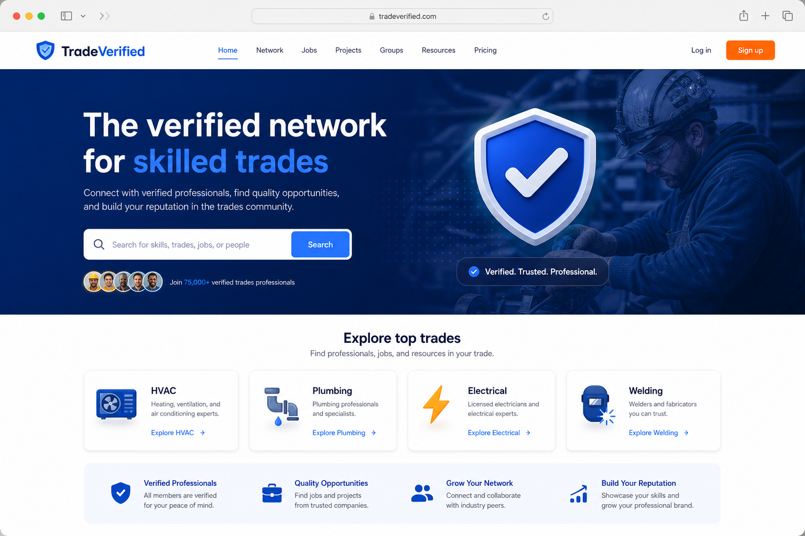
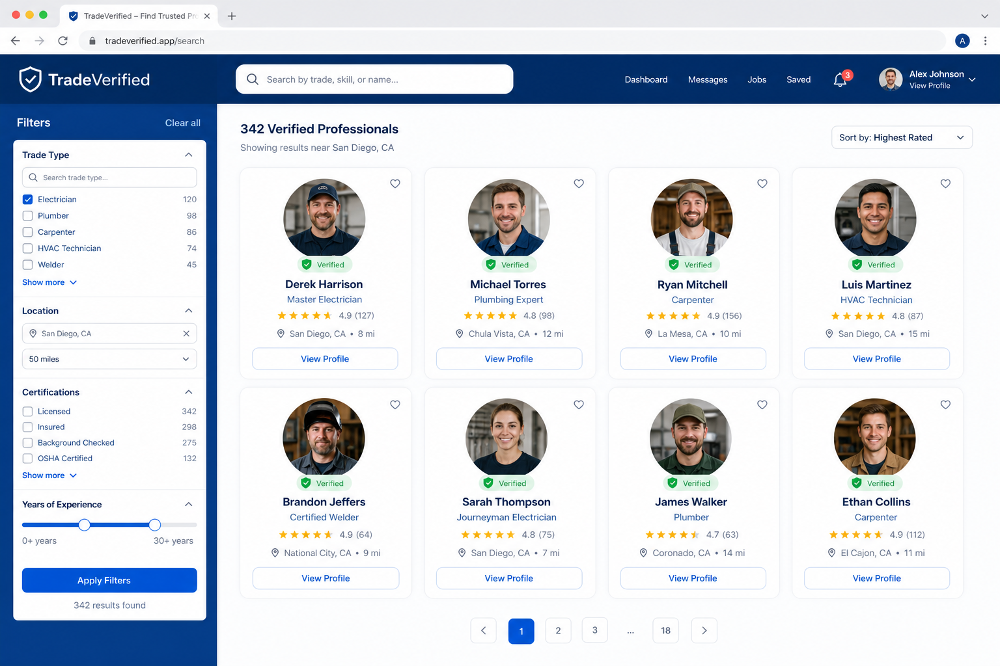
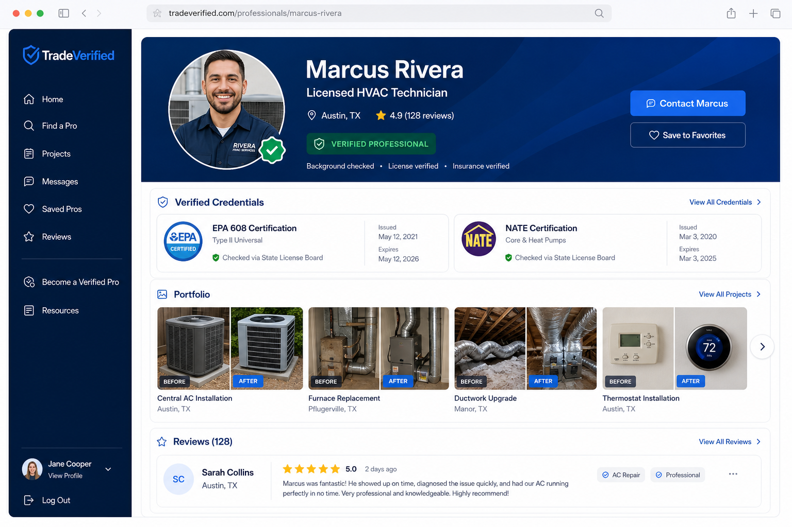
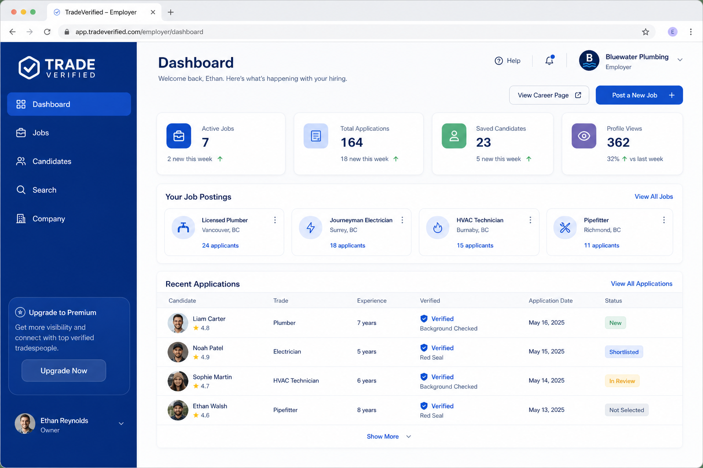

# TradeVerified

The verified professional network for skilled trades workers and the companies that hire them.

## Overview

TradeVerified is a LinkedIn-style SaaS platform built for the skilled trades. HVAC technicians, plumbers, electricians, welders, carpenters, mechanics, and construction workers build verified profiles, showcase portfolio work, earn proof-backed reviews, and apply to jobs. Employers post roles, search verified talent, and hire with confidence.

This repository contains the product marketing site and design preview (`index.html`), along with case study documentation for the full product concept.

## Problem

Skilled trades hiring still runs on trust that is hard to prove. Workers lose jobs to cheaper, unverified competitors. Employers waste time and money on resumes that hide fake licenses and weak work history. Generic job boards and social networks were not built around trade licenses, certifications, or portfolio craftsmanship.

## Solution

TradeVerified makes trust visible. Workers create free profiles, upload credentials, and earn verification badges that show how and where each license was checked. Employers search by trade, certification, and location, then review portfolios and proof-backed ratings before hiring. Pricing stays worker-first: free to find work, optional Pro for visibility, and employer subscriptions for hiring tools.

## My Role

- Product Designer
- UX/UI Designer
- Frontend Developer
- Project Manager

## Process

1. Discovery
2. Research
3. Wireframes
4. Design
5. Development
6. Testing
7. Launch

## Tech Stack

- HTML / CSS / JavaScript (marketing site)
- Figma (product UI and brand)
- Next.js (full app architecture)
- React
- TypeScript
- Tailwind CSS
- Supabase (auth, database, storage)
- Stripe (subscriptions)
- PostgreSQL
- Vercel (app deployment target)

## Features

- Verified tradesperson profiles with licenses and certifications
- Before/after portfolio uploads
- Proof-backed customer reviews
- Marketplace search by trade, location, and credentials
- Employer job posting and candidate management
- Automated and manual credential verification with visible provenance
- Free worker plan plus optional Pro and Employer pricing
- Dark / light theme support on the marketing site

## Screenshots

### Landing page

### Worker marketplace

### Verified profile

### Employer dashboard

## Live Demo

[Open the marketing site](https://ogxmaxeimus.github.io/tradeverified/)

*(After GitHub Pages is enabled, or open `index.html` locally.)*

## Case Study

[View case study in Brandon Fonville Creative Studio](https://github.com/ogxmaxeimus/brandon-fonville-studio)

## Status

Concept
