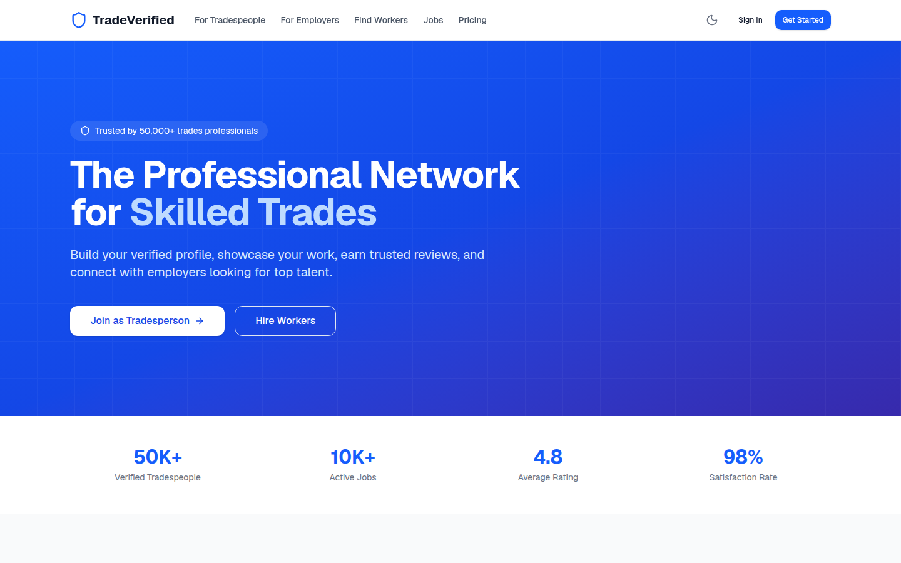
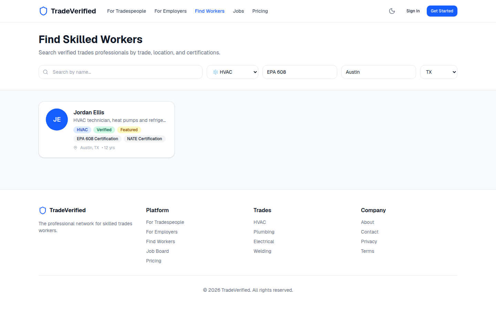
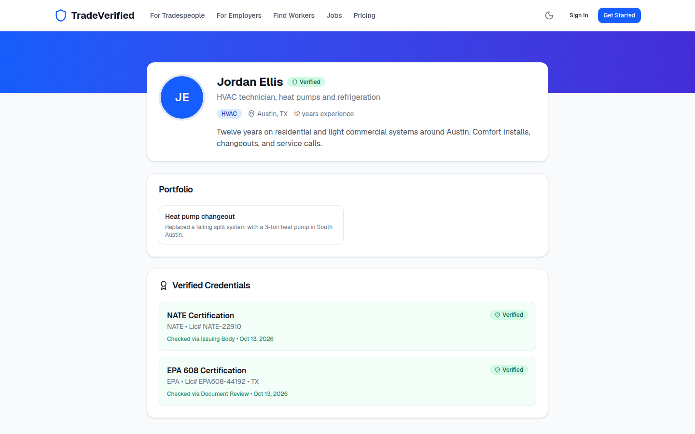
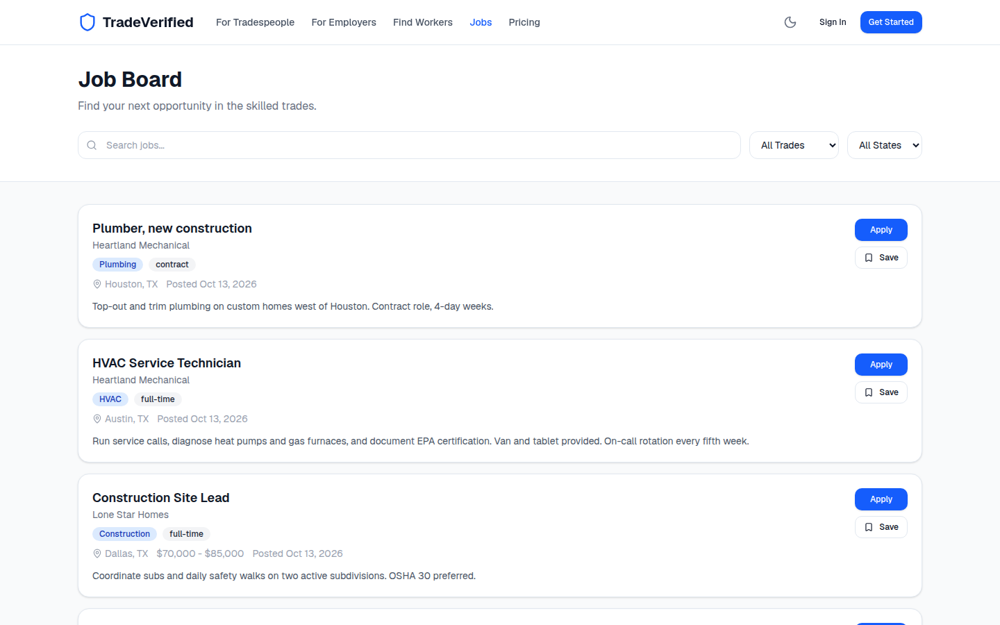
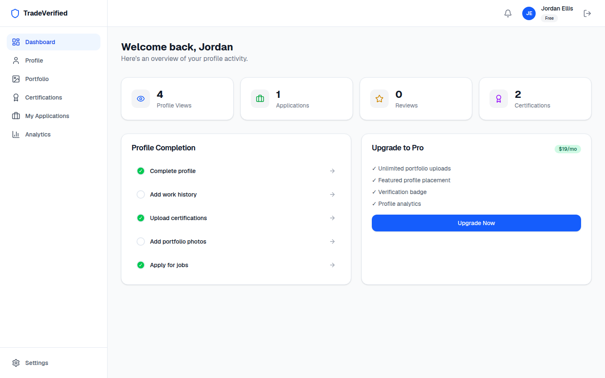
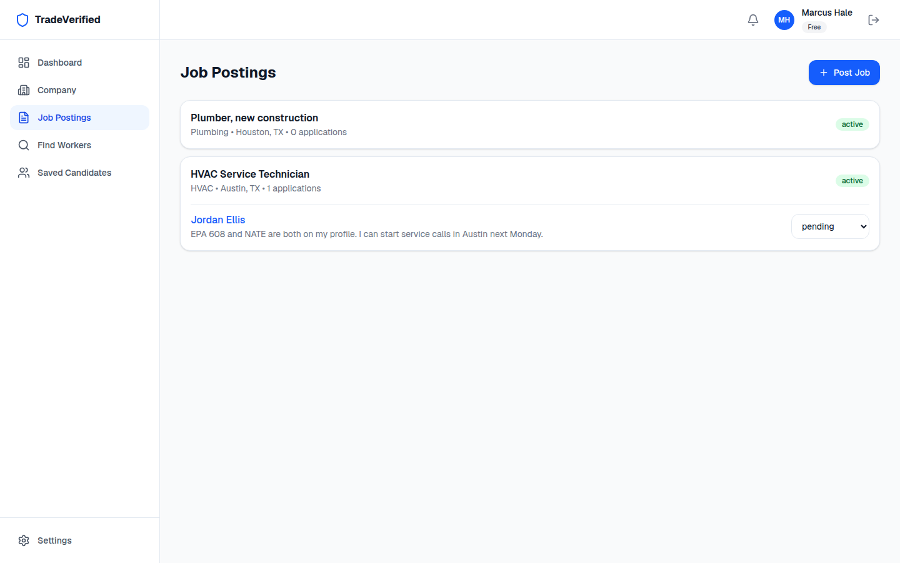
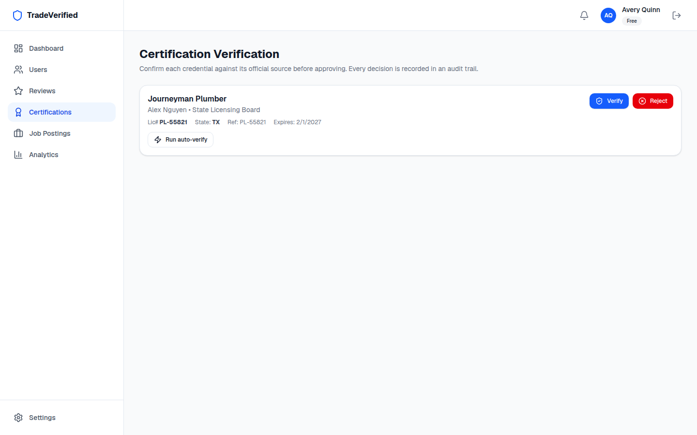

# TradeVerified

The verified professional network for skilled trades workers and the companies that hire them.

HVAC technicians, plumbers, electricians, welders, carpenters, mechanics, and construction workers build profiles, upload licenses, and apply to jobs. Employers post roles and search by trade, certification, and location. An admin reviews credentials that an automated source cannot confirm.

This repository has two parts:

- `index.html` is the concept and design preview.
- The Next.js app in `src/` is the pilot product, backed by Supabase.

Product notes live in `docs/ROADMAP.md`, `docs/VERIFICATION.md`, `docs/MONETIZATION.md`, and `docs/COMPETITIVE_ANALYSIS.md`.

## Pilot screenshots









The original concept mockups are still in `screenshots/tv-landing.png`, `screenshots/tv-marketplace.png`, `screenshots/tv-profile.png`, and `screenshots/tv-dashboard.png`.

## Pilot scope

Tradespeople and employers sign up with email and password. Signup metadata can choose `tradesperson` or `employer`. It cannot grant `admin`. A tradesperson picks a trade, uploads a license or certification, and adds portfolio photos. The upload stays pending. An admin approves or rejects it from the verification queue, and one verified credential turns on the profile badge. Texas TDLR and TradeProof lookups run when their keys are set; otherwise the same queue handles the review. Employers post jobs, search workers, and update applications. Workers apply from the jobs board.

Billing, reviews, messages, and saved candidates are in the app and ready for keys and moderation. They are not required to run the hiring loop.

## Run it locally

You need Node.js 22+ and Docker.

```bash
npm install
supabase start
```

`supabase start` prints the API URL, the anon key, and the publishable key. Copy them into `.env.local`:

```bash
cp .env.example .env.local
```

```
NEXT_PUBLIC_SUPABASE_URL=http://127.0.0.1:54321
NEXT_PUBLIC_SUPABASE_ANON_KEY=<anon key from supabase status>
NEXT_PUBLIC_SUPABASE_PUBLISHABLE_KEY=<publishable key from supabase status>
SUPABASE_SERVICE_ROLE_KEY=<secret key from supabase status>
```

The service role key is server-only. Do not prefix it with `NEXT_PUBLIC_`.

```bash
npm run dev
```

Open [http://127.0.0.1:3000](http://127.0.0.1:3000).

`supabase start` applies `supabase/migrations` and `supabase/seed.sql`. To wipe local data and load the demo again:

```bash
supabase db reset
```

Check the database for security and performance advice after schema changes:

```bash
supabase db advisors --local
```

`npm run verify` signs in as the demo accounts and walks search, credential review, job posting, and apply against the local API. It restores the rows it creates, except for one throwaway signup used to prove that requesting the admin role does not grant it.

## Demo accounts

Every seeded account uses the password `pilot-demo-2026`.

| Role | Email |
| --- | --- |
| Admin | avery.quinn@tradeverified.dev |
| Employer | marcus.hale@tradeverified.dev |
| Employer | priya.shah@tradeverified.dev |
| Tradesperson | jordan.ellis@tradeverified.dev |
| Tradesperson | sam.rivera@tradeverified.dev |
| Tradesperson | alex.nguyen@tradeverified.dev |
| Tradesperson | riley.brooks@tradeverified.dev |
| Tradesperson | casey.morgan@tradeverified.dev |
| Tradesperson | drew.patel@tradeverified.dev |

Alex's plumber license is pending, so the review queue is not empty. Riley has no credential yet. Jordan is a verified HVAC tech in Austin with EPA 608. Do not run `supabase/seed.sql` on a production database. It creates known passwords.

To make another reviewer, sign up a normal account and then, in the Supabase SQL editor:

```sql
update public.profiles
set role = 'admin'
where id = '<user uuid>';
```

Signup metadata cannot set `admin`. The role lives on `profiles`, not in editable user metadata.

## Deploy on Vercel and Supabase

1. Create a Supabase project.
2. Install the [Supabase CLI](https://supabase.com/docs/guides/local-development/cli/getting-started), then from this repo:

   ```bash
   supabase link --project-ref <project-ref>
   supabase db push
   ```

   That applies migrations `001` through `004`, including the private `certifications` bucket and the public `portfolio` bucket. Skip `seed.sql` on production.
3. In Authentication settings, set the site URL to the Vercel domain and add `https://<your-app>.vercel.app/callback` to the redirect URLs. Turn on email confirmations once SMTP is configured. The local config leaves confirmations off so a pilot signup works without mail.
4. Create a Vercel project from this repository. Set:

   - `NEXT_PUBLIC_SUPABASE_URL`
   - `NEXT_PUBLIC_SUPABASE_ANON_KEY` (or `NEXT_PUBLIC_SUPABASE_PUBLISHABLE_KEY`)
   - `SUPABASE_SERVICE_ROLE_KEY` (server only, for auto-verify and Stripe webhooks)
   - `NEXT_PUBLIC_APP_URL`

   Add Stripe, Resend, `TRADEPROOF_API_KEY`, and `TEXAS_OPEN_DATA_TOKEN` when those features should leave the queue. `vercel.json` sets the security headers for the deployment.
5. Deploy. Create the first admin with the SQL above.
6. The concept page (`index.html`) can stay on GitHub Pages. The Vercel app is the product.

## Before a production launch

- Confirm email and password reset with Resend or another SMTP provider
- Delete the demo users and rotate anything seeded into a shared project
- Put live Stripe prices in the env vars from `docs/MONETIZATION.md` and confirm the webhook
- Turn on TradeProof or state-board tokens where a public lookup exists; keep the admin queue for EPA, NATE, AWS, ASE, and OSHA
- Moderate proof-backed reviews before they are public
- Captcha and rate limits on signup
- Backups, error tracking, terms, and a privacy notice
- Remove `robots: noindex` in `src/app/layout.tsx` when the app should be indexed
- Invite admins without handing someone the SQL editor
